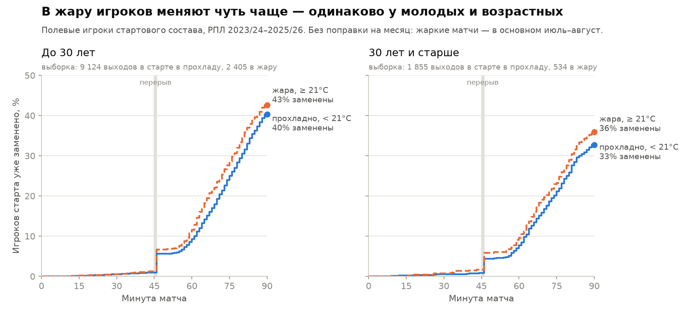
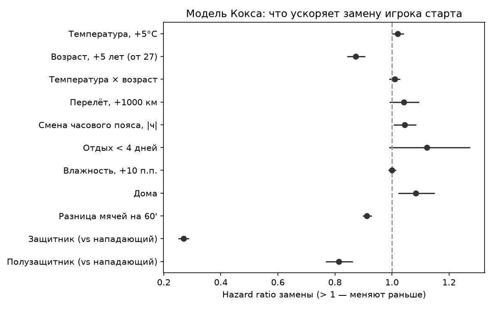

# Жара, перелёты и возраст в РПЛ: ETL + Data Quality

Пет-проект по футбольной аналитике. **Вопрос:** меняют ли жара, перелёты, смена часовых поясов и возраст игрока то, как команды РПЛ проводят концовку матча и когда тренеры меняют игроков?

**Главное в проекте — не модель, а данные под ней:** воспроизводимый пайплайн из трёх открытых источников, сопоставление идентификаторов между ними и автоматические проверки качества. Они нашли в исходных данных реальные проблемы, которые без проверок молча испортили бы вывод.

РПЛ, сезоны 2023/24–2025/26: 720 матчей, ~32 000 записей «игрок × матч», ~18 000 ударов с xG, погода по часам для каждого стадиона.

## Ключевые находки по качеству данных

Полный отчёт: [reports/dq_report.md](reports/dq_report.md) (19 проверок, генерируется автоматически).

1. **В API РПЛ метка «UTC» на самом деле означает московское время.** `2025-07-18UTC20:30:00` — это 20:30 МСК, а не UTC. Подтверждено сверкой с Understat: после перевода МСК→UTC время начала совпадает (±15 мин) в 685 из 720 матчей. Если поверить метке, погода берётся на 3 часа позже: **в среднем на 2,0°C неверно, в худшем случае на 7,9°C**. Для исследования о влиянии температуры это ошибка прямо в главной переменной.
2. **Understat хранит время не в чистом UTC.** Оставшиеся расхождения в ±60 минут скапливаются у дат перевода часов в Европе (31.03.2024, 30.03.2025, 26–27.10.2025). Поэтому эталон времени — РПЛ (Москва, без переводов часов), а Understat используется только для сверки.
3. **Два «Динамо».** В РПЛ два разных клуба: «Динамо» Москва и «Динамо» Махачкала. Understat пишет их по-разному (`Dinamo Moscow` / `Dynamo Makhachkala`), поэтому любая нормализация строк рискует их склеить. Команды сопоставляются **не по названию, а по сыгранным матчам** (одна дата + один счёт). Каждая из 19 команд подтверждена всеми своими матчами, соответствие проверено тестом «один к одному».
4. **Коды событий API РПЛ не документированы.** Расшифровка выведена из данных и доказана тестом: голы (`1`, `10`) с учётом автоголов (`11`, засчитываются сопернику) совпадают с итоговым счётом во всех 720 матчах.
5. **Стадион клуба ≠ стадион матча.** API отдаёт только *текущий* стадион клуба. «Акрон» и «Крылья Советов» делят арену в Самаре, «Пари НН» в 2025/26 проводил домашние матчи в Казани, Грозном и Саранске. Домашний стадион определяется по данным (где команда чаще всего играла дома в этом сезоне), а координаты для погоды и перелётов берутся по стадиону конкретного матча.
6. **Дефекты источников, которые проверки поймали и оставили как предупреждения:** 2 протокола РПЛ с 10 игроками в старте, 6 случаев шести замен (вероятно, доп. замена при сотрясении), задублированные и неполные составы в Understat (29 дублей, 10 матчей с расхождением по числу сыгравших).

## Результаты

Полный отчёт с таблицами и графиками: [reports/analysis.md](reports/analysis.md).

Физику (пробег, спринты) по РПЛ поматчево публично не выдают, поэтому вместо неё используются **поведенческие прокси усталости** из событий:

- **A (основная): время до замены** игрока стартового состава. Модель Кокса, 13 918 записей, стандартные ошибки кластеризованы по матчу, фиксированные эффекты месяца.
- **B:** xG в минуту за 75'+ относительно 0–60' с разбивкой по счёту на 60'.
- **C:** минута первой замены и число замен к 60'.

| Фактор | HR замены | 95% ДИ | Вывод |
|---|---|---|---|
| Температура, +5°C | 1,020 | 1,000–1,041 | слабый эффект на грани значимости |
| Возраст × температура | 1,010 | 0,990–1,029 | **нет признаков**, что возрастным игрокам жара даётся тяжелее |
| Возраст, +5 лет | 0,873 | 0,842–0,906 | игроков 30+ из старта меняют **позже** |
| Смена часового пояса, за час | 1,045 | 1,006–1,085 | слабый эффект |
| Перелёт, +1000 км | 1,042 | 0,991–1,095 | не значим |
| Отдых < 4 дней | 1,122 | 0,989–1,274 | на грани, в нужную сторону |



*Доля игроков старта, ещё не заменённых к данной минуте. Пунктир — матчи при ≥ 21°C. Красные линии (30+) идут выше синих: возрастных игроков меняют позже, в жару и в прохладу.*



*HR > 1 — игрока меняют раньше. Точка — оценка, отрезок — 95% доверительный интервал; если он пересекает пунктир (HR = 1), эффект не отличим от нуля.*

**Как это читать — честно:**

- **Гипотеза «возрастным игрокам тяжелее в жару» на этих данных не подтвердилась.** Возрастных игроков в старте, наоборот, держат на поле дольше. Скорее всего, это отбор: в старт в 30+ попадают ключевые, проверенные игроки.
- **Сырой эффект жары в основном объясняется календарём.** Без поправок в жару первая замена приходит на 3,7 минуты раньше (54,2' против 57,9' при < 10°C), а замен к 60' больше (1,14 против 0,85). Но жара в РПЛ — это почти всегда июль–сентябрь, начало сезона с ротацией и набором формы. После поправки на месяц остаётся HR 1,020, на грани значимости.
- **Отрицательный контроль не пройден чисто.** В первые 30 минут, где усталости ещё нет, эффект температуры той же величины (HR 1,030, p = 0,08). Значит, даже остаточный эффект нельзя уверенно назвать усталостью.
- **Метрика B не показывает систематического падения атаки в концовке в жару**, если смотреть внутри одинакового счёта.

Нулевой результат — тоже результат. Главный практический вывод: **на открытых событийных данных влияние жары на усталость не отделить от календаря и тактики.** Для этого нужны трекинг или GPS, то есть ровно те внутренние данные, с которыми работает клуб. Каркас проекта готов их принять: витрина `mart.starter_exposure` дополняется пробегом и высокоинтенсивным бегом по тем же ключам «игрок × матч».

## Архитектура

```
API РПЛ ─┐                       ┌─ stg.*  (типы, МСК→UTC, расшифровка событий)
Understat ├─► data/raw/*.json ─► raw.* ─┤─ xref.* (команды и матчи между источниками)
Open-Meteo┘   (кэш ответов)      └─ mart.* (витрины для анализа) ─► DQ-отчёт ─► анализ
```

| Слой | Где | Что делает |
|---|---|---|
| Extract | [src/load_rpl.py](src/load_rpl.py), [src/load_understat.py](src/load_understat.py), [src/load_weather.py](src/load_weather.py) | Скачивает только то, чего ещё нет в кэше; ответы хранятся как есть, атомарная запись файлов, повторы с backoff |
| Raw | [src/build_raw.py](src/build_raw.py) | JSON → таблицы `raw.*` в DuckDB, без преобразований |
| Staging | [sql/01_staging.sql](sql/01_staging.sql) | Типы, перевод часовых поясов, расшифровка кодов событий |
| Xref | [sql/02_xref.sql](sql/02_xref.sql) | Сопоставление команд и матчей РПЛ ↔ Understat по фикстурам, а не по названиям |
| Marts | [sql/03_marts.sql](sql/03_marts.sql) | `team_match` (погода, перелёт, часовой пояс, отдых), `starter_exposure` (метрика A), `team_match_late` (B, C) |
| DQ | [src/dq.py](src/dq.py) | 19 проверок: `error` останавливает пайплайн, `warn` попадает в отчёт |
| Analysis | [src/analysis.py](src/analysis.py) | Модель Кокса (lifelines), Kaplan–Meier, отрицательный контроль, таблицы B/C |
| Seeds | [seeds/venues.csv](seeds/venues.csv) | Стадионы: координаты, UTC-смещение, источник координат |

## Запуск

```bash
pip install -r requirements.txt
python -m src.pipeline           # загрузка (~15 мин в первый раз) + сборка + DQ
python -m src.analysis           # модель и отчёт reports/analysis.md
python -m src.pipeline --offline # пересборка из кэша, без сети
```

База — один файл DuckDB `data/dynamo.duckdb`, никаких серверов. Пайплайн завершается с ненулевым кодом, если упала хотя бы одна проверка уровня `error`, поэтому его можно ставить в расписание.

## Ограничения

- **Прокси, а не физика.** Замена — решение тренера: в ней смешаны усталость, тактика, травмы и карточки. Частично это контролируется (счёт на 60', позиция, место проведения, месяц), но не полностью.
- **Мощность.** 147 матчей при ≥ 21°C и 534 записи «игрок 30+ в жару»: слабые эффекты взаимодействия не обнаружить даже при их наличии.
- **Дни отдыха считаются только по матчам РПЛ.** Кубок России не загружен, поэтому для команд, игравших в Кубке, отдых завышен. Первый матч команды в сезоне исключён из модели.
- **Перелёт** считается от домашнего стадиона до места матча (по прямой), без учёта реального маршрута и выездов подряд.
- **Множественные проверки.** Факторов много, поэтому результаты с p ≈ 0,02–0,05 стоит считать гипотезами, а не выводами.

## Следующие шаги

- Загрузить Кубок России и пересчитать дни отдыха.
- Сверка с реальной физикой: сезонный средний пробег команд из отчётов РПЛ (около 48 точек «команда × сезон») против индекса раннего ухода.
- Перенос SQL в dbt (`dbt-duckdb`), а проверок — в `dbt tests`; запуск по расписанию в Prefect; хранилище PostgreSQL или ClickHouse.
- Дашборд в DataLens поверх `mart.*`.

## Источники

- [API официального сайта РПЛ](https://premierliga.ru) — календарь, протоколы, события, профили игроков, стадионы.
- [Understat](https://understat.com/league/RFPL) — удары с xG, составы.
- [Open-Meteo Historical Weather API](https://open-meteo.com/en/docs/historical-weather-api) — почасовая погода (реанализ).
- Порог 21°C — по исследованию трекинга матчей Лиги чемпионов 2022/23 ([Cardiff Met](https://pure.cardiffmet.ac.uk/en/publications/temperature-related-variations-in-physical-performance-during-eli/)).
- Ранняя оценка источников: [docs/01_data_sources.md](docs/01_data_sources.md).
